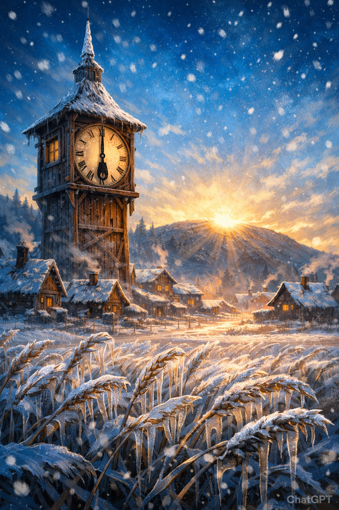
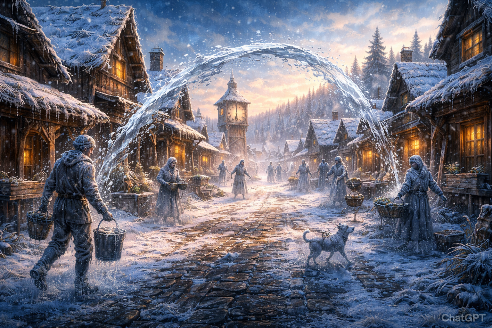
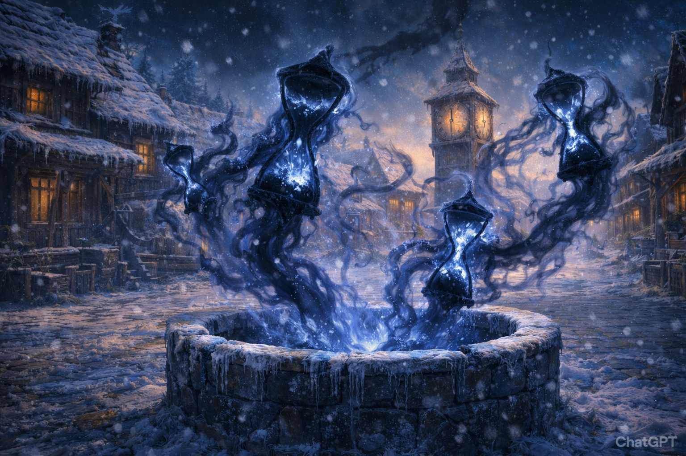
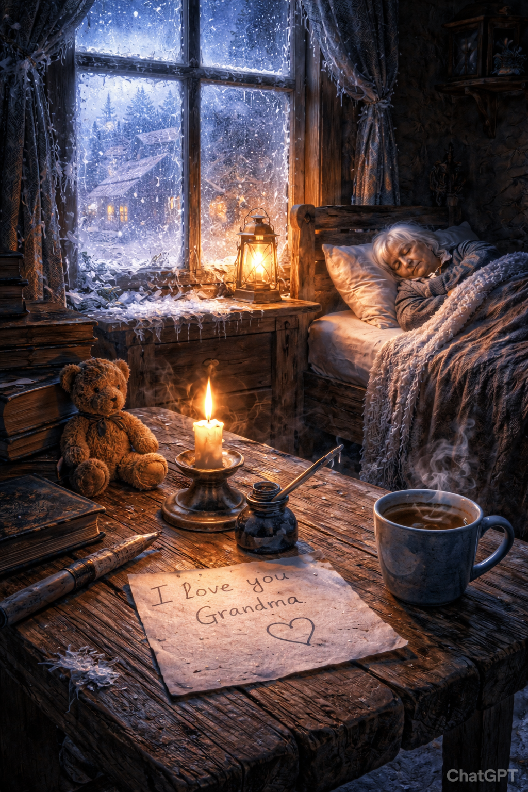
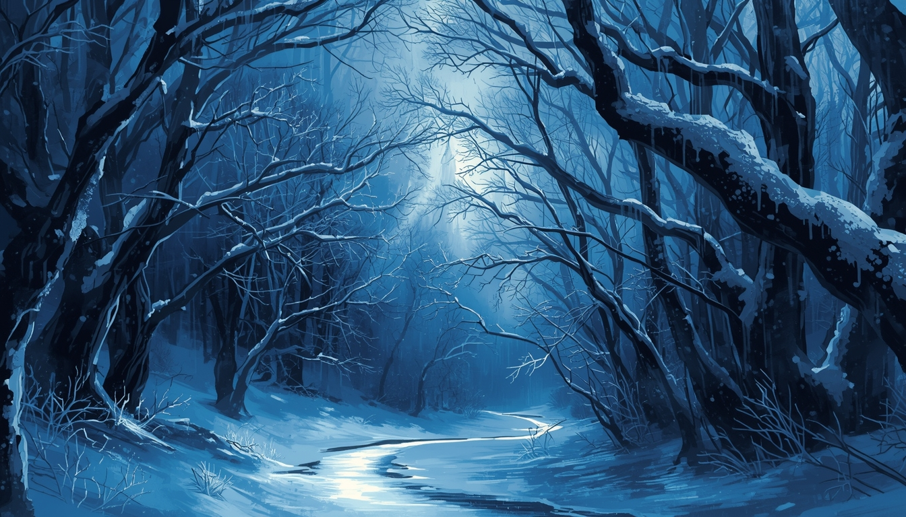
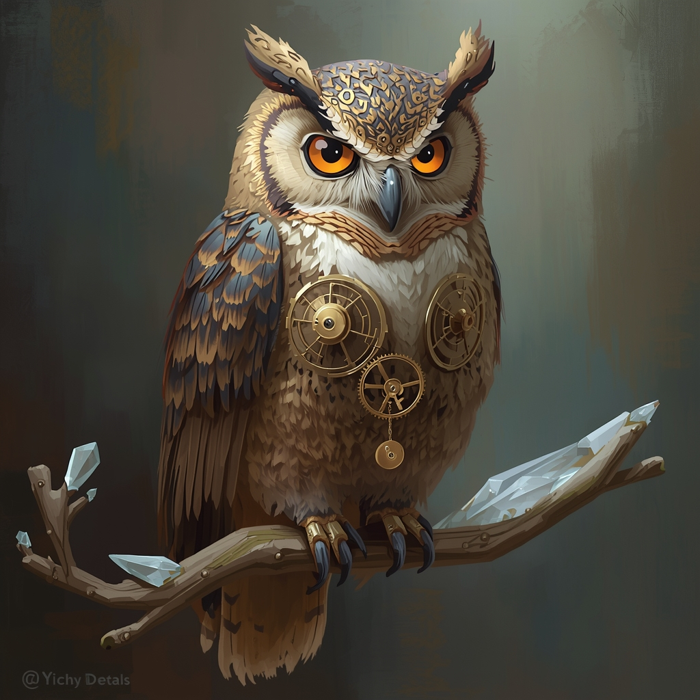
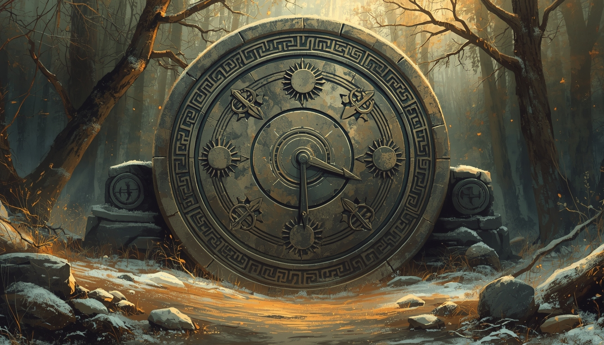
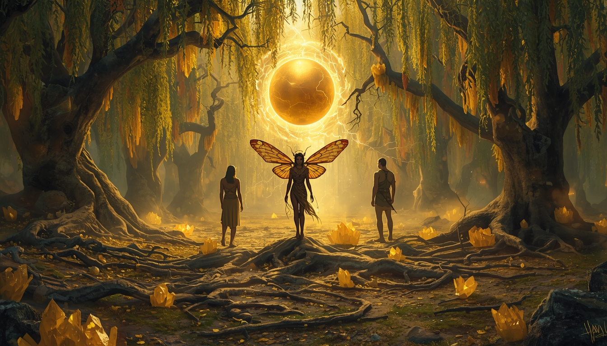
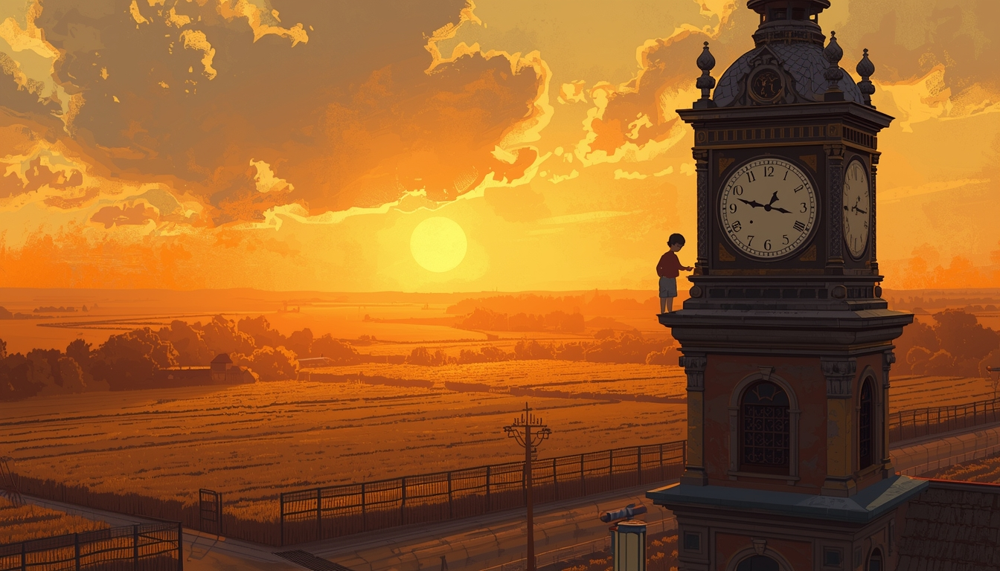

# El Pueblo que Olvidó el Sol

---

## Introducción para el Master: La Travesía hacia Vallegrana

Lee o parafrasea este texto antes de comenzar la aventura:

> "El viaje hasta Vallegrana es largo y silencioso. Los caminos rurales se vuelven cada vez más fríos y desolados a medida que los personajes se acercan al valle. El sol parece quedarse atrapado tras nubes de escarcha, y el aire se vuelve más denso, como si el tiempo mismo se ralentizara. Los árboles, cubiertos de una fina capa de hielo, se inclinan sobre el sendero, y el único sonido es el crujir de la escarcha bajo las botas. A lo lejos, el perfil del pueblo se recorta contra un cielo azul eléctrico, inmóvil, esperando a quienes se atreven a romper su quietud."

Esta escena prepara el ambiente y anticipa la sensación de tiempo detenido que dominará la aventura.

*Una aventura de fantasía y tiempo detenido para DnD 5e*

---

**Oneshot para DnD 5e (nivel 3, 4 jugadores)**

**Ambientación:** Vallegrana, el pueblo donde el amanecer se congeló a las 05:59.

**Temas:** pérdida, esperanza, el costo de detener el tiempo.

**Duración sugerida:** 3 a 4 horas.

**Para el Director de Juego:** lectura en mesa con escenas marcadas, encuentros y dilema final.

---

> *"El niño pidió un minuto más, y el bosque le concedió una eternidad."*

## Introducción

Esta aventura para personajes de nivel 3 comienza en los límites de Vallegrana, un asentamiento agrícola que solía ser famoso por sus campos dorados de cereal. Ahora, el trigo está cubierto por una escarcha vítrea que no se derrite, y el cielo se ha teñido de un azul eléctrico permanente.

**Gancho para los PJ:** Los personajes son hermanos. Uno de ellos vive en Vallegrana y dejó de responder. La última carta menciona "el reloj detenido" y termina con una frase incompleta.

**Recompensa sugerida:** 100 po por PJ y un objeto mágico menor (ver Epílogo).

## Atmósfera: El Invierno Azulado

Mientras los aventureros se acercan, describe lo siguiente:

- **Visual:** Partículas de luz blanca flotan inertes en el aire, como polvo de estrellas congelado. Las hojas que caen de los árboles no llegan al suelo; se quedan suspendidas a media altura.
- **Sonido:** Un silencio sepulcral. No hay pájaros, ni viento, ni ladridos. Solo el crujir del metal bajo las botas de los héroes.

**Consejo de ritmo:** Las lecturas DM son opcionales. Si la mesa va lenta, usa solo la primera frase de cada cuadro de lectura.

## Acto 1: El Pueblo Criogenizado

> **Lectura DM (inicio del Acto 1):** "El camino se vuelve rígido bajo vuestros pasos. Vallegrana os espera en silencio, como una foto que nunca termina de revelarse."

### Escena 1: La Frontera del Tiempo

Lee o parafrasea lo siguiente:

> El frío no te golpea; te envuelve como una mortaja de seda. Al cruzar el límite del pueblo, el color del mundo cambia. Las sombras son largas y azuladas, y el sol, atrapado justo tras la colina del este, emite un resplandor agónico que nunca termina de alzarse.
>
> En la calle principal, los aldeanos parecen estatuas de cera en un museo de lo cotidiano. Una mujer vuelca un cubo de agua que ha quedado congelado en el aire en un arco perfecto de cristal; un panadero bosteza eternamente frente a su puerta. Se mueven, sí, pero con una lentitud tan extrema que un parpadeo les toma minutos.

> **Lectura DM (familiar):** "Entre las figuras ralentizadas reconocéis a vuestro hermano. Sus labios forman vuestros nombres, pero el sonido nunca llega. En su mano hay una carta doblada, congelada a medio gesto." 

**Contenido de la carta de Hengrid:**

> Queridos hermanos:
>
> Algo extraño ocurre en Vallegrana. El sol no ha salido en días, y la escarcha cubre todo como si el tiempo se hubiera detenido. La abuela Martha duerme y no despierta, pero su pecho aún se mueve, lento como el reloj de la plaza.
>
> Anoche escuché un susurro en el viento, y vi una figura con alas de polilla junto al pozo. Dijo que el tiempo aquí ya no pertenece al sol, sino a un pacto antiguo.
>
> Si recibís esta carta, venid pronto. El reloj está detenido y siento que, si no hacemos algo, el amanecer nunca volverá.
>
> Con esperanza,
>
> Hengrid

**El reloj de la plaza.** En el centro del pueblo se alza una torre de madera. Las manecillas de hierro están fijas en las 05:59. Si un jugador intenta moverlas a la fuerza, sentirá una resistencia mística inamovible (CD 16 de Fuerza para notar que el mecanismo no está roto, sino "anclado" a la realidad).

> **Lectura DM:** "El tic del reloj no existe. En su lugar hay un silencio pesado, como si el pueblo contuviera la respiración. La sombra de la manecilla marca las 05:59 y no avanza, ni siquiera cuando las nubes se mueven."

---
**Notas y sugerencias para el DM (Escena 1)**

- Puedes añadir una frase de transición entre la travesía y la llegada al pueblo para reforzar la inmersión.
- Si los jugadores intentan interactuar con los aldeanos ralentizados, describe que pueden tocarlos, pero sus movimientos son tan lentos que no pueden responder ni ser ayudados fácilmente. Si insisten, permite tiradas de Arcana o Medicina para obtener pistas sobre la anomalía temporal.
- Si los jugadores examinan el reloj de la plaza con magia o fuerza, aclara que ningún método convencional (ni Disipar Magia ni Fuerza bruta) puede romper el anclaje, pero pueden percibir una energía feérica si usan Detectar Magia.
- Si los PJ examinan a su hermano o la carta congelada, permite que obtengan pistas: la carta puede contener palabras clave sobre el tiempo detenido o el nombre de Aurelius.
- Para reforzar la atmósfera, puedes describir detalles adicionales: animales congelados en mitad de un salto, relojes parados en las casas, o el vaho de la respiración suspendido en el aire.
- Usa las lecturas DM para marcar momentos clave, pero si la mesa prefiere ritmo rápido, resume la ambientación y pasa a la acción.
---

### Escena 2: Encuentro - Las Sombras del Reloj

Mientras los héroes investigan la plaza, el estancamiento temporal reacciona ante su presencia "acelerada". Del pozo central y de las grietas de la torre del reloj emergen dos figuras etéreas.

**Combate: Sombras de Arena.** Estas criaturas son Sombras (Manual de Monstruos), pero visualmente parecen siluetas de relojes de arena rotos. En lugar de drenar fuerza, su toque inflige daño de frío y ralentiza. Usa las estadísticas de Sombra, pero:
- El daño es de frío.
- El ataque reduce la velocidad del objetivo en 3 metros hasta el final de su siguiente turno (acumulable).
- Si el grupo es experimentado o avanza muy rápido, una tercera Sombra debilitada (mitad de HP, daño reducido a la mitad) puede aparecer como refuerzo en la ronda 3.

---
**Estadísticas de la Sombra de Arena**

*No muerto, caótico maligno*

**Clase de Armadura:** 12
**Puntos de Golpe:** 16 (3d8+3)
**Velocidad:** 12 m (40 pies)

| Fuerza | Destreza | Constitución | Inteligencia | Sabiduría | Carisma |
|--------|----------|--------------|--------------|-----------|---------|
|   6    |   14     |     13       |      6       |    10     |    8    |

**Resistencias a daño:** ácido, frío, fuego, relámpago, trueno; contundente, cortante y perforante de ataques no mágicos
**Inmunidad a daño:** necrótico, veneno
**Inmunidad a condiciones:** agotado, asustado, agarrado, paralizado, petrificado, envenenado, tumbado, apresado
**Sentidos:** visión en la oscuridad 18 m, Percepción pasiva 10
**Idiomas:** comprende los idiomas que conocía en vida, pero no puede hablar
**Desafío:** 1/2 (100 PX)

**Amorfia:** Puede moverse a través de una rendija de 2,5 cm sin reducir su velocidad.
**Oscuridad sombría:** La luz brillante en un radio de 6 m alrededor de la sombra se reduce a luz tenue.

**Toque helado.** Ataque cuerpo a cuerpo con arma: +4 al ataque, alcance 1,5 m, un objetivo. 
Impacto: 9 (2d6 + 2) de daño de frío. Si el objetivo es una criatura, su velocidad se reduce en 3 metros hasta el final de su siguiente turno (acumulable). Si la criatura muere por este ataque, su sombra se levanta como una nueva Sombra de Arena al siguiente turno.

**Sombra debilitada:** (opcional, ronda 3) HP 8 (mitad), daño reducido a la mitad.

**Nota:** Esta criatura reemplaza el daño necrótico y el drenaje de fuerza por daño de frío y reducción de velocidad, según la aventura.
---

> **Lectura DM:** "Del pozo ascienden figuras sin rostro. En sus torsos, la arena cae al revés; cada grano que sube roba el calor de vuestras manos."

**Mecánica ambiental: Pulso Temporal.** Al final de cada 2 rondas (iniciativa 0), el tiempo da un "salto" violento. Todos los jugadores deben realizar una TS de Sabiduría (CD 10, o 12 si el grupo es experimentado).
- **Fallo:** La velocidad del personaje se reduce a la mitad hasta el final de su siguiente turno. Sus movimientos se ven desfasados, como si lucharan bajo el agua.

### Escena 3: La Pista en la Casa de la Abuela

Tras el combate, el silencio regresa, pero algo destaca. Una de las casas, situada al borde del bosque, emite una luminiscencia azulada más intensa que el resto. Es la casa de Leo y su abuela, Martha.

Al entrar, los jugadores encuentran una escena desgarradora:

> **Lectura DM:** "La casa huele a pan que nunca terminó de cocerse. La luz del amanecer se cuela por la ventana y se queda inmóvil, como si alguien la hubiera clavado en el aire."

En una repisa hay un dibujo infantil: un sol grande sobre Vallegrana y, debajo, Leo y su abuela sonriendo. Junto al dibujo hay un pequeño reloj de madera tallado, gastado por el uso.

Si los PJ deciden buscar a su hermano, pueden encontrar su casa con un **rastro de escarcha tenue** que conduce hacia el bosque, mezclado con huellas pequeñas, como si hubiera seguido a alguien en la noche detenida.

- **La abuela Martha:** Yace en una cama cerca de la ventana, con el rostro pálido y la respiración tan lenta que es casi imperceptible.
- **La nota:** Sobre la mesa de la cocina, escrita con trazos infantiles y desesperados, hay una nota de Leo:

> "El señor de las alas de polilla dijo que si el sol no sale, el mañana nunca llegará. Y si el mañana no llega, tú no te irás, abuelita. No dejaré que el sol te lleve".

**Investigación y rastreo**

- **Percepción (CD 11):** Los jugadores notan que la ventana de la habitación está abierta de par en par. En el alféizar hay huellas de pies pequeños, mezcladas con un polvo brillante que recuerda a las escamas de una polilla.
- **Supervivencia (CD 10):** Un rastro de escarcha luminosa sale de la casa y se interna directamente en el Bosque de los Suspiros. El rastro palpita al ritmo de un corazón lejano.

> **Lectura DM (éxito Percepción):** "Ves huellas pequeñas en el alféizar. Entre el polvo, algo brilla como escamas de polilla, y la ventana abierta deja entrar un frío que no es de este mundo."
>
> **Lectura DM (fallo Percepción):** "La habitación parece intacta, salvo por el frío. Nada se mueve, pero sientes que algo se fue por aquí."
>
> **Lectura DM (éxito Supervivencia):** "El rastro de escarcha palpita como un corazón distante. Marca una línea clara hacia el bosque."
>
> **Lectura DM (fallo Supervivencia):** "La escarcha se vuelve difusa, como si la tierra misma dudara del camino. Avanzar os costará tiempo."

---

### Transición al Acto 2

A medida que los aventureros dejan atrás las casas congeladas y se acercan a la linde del bosque, la temperatura baja aún más. El cielo, antes azul claro, se vuelve de un índigo profundo. El tiempo externo corre, y el Círculo de la Cosecha les recordó que solo tienen 24 horas antes de que el suelo se vuelva estéril para siempre.

**Reloj de 24 horas (presión de tiempo).** Marca 4 segmentos. Comienza a contar desde que los PJ entran en Vallegrana. Avanza 1 segmento cada vez que el grupo falla una prueba de grupo importante (como el rastreo del bosque) o decide tomar un descanso largo. Cuando el reloj se llena, el suelo se vuelve estéril y el epílogo se oscurece (los campos tardan años en recuperarse). Si el grupo está en apuros, Tic-Tac puede ofrecer una bendición menor: ventaja en una tirada clave del ritual o exploración, a cambio de un recuerdo feliz (rol puro).

> **Lecturas por segmento del reloj:**
>
> - **Segmento 1:** "El azul del cielo se oscurece un matiz. El aire huele a metal frío."
> - **Segmento 2:** "La escarcha cruje bajo las botas. Notáis que las hojas se quedan quietas, como si el bosque dudara."
> - **Segmento 3:** "Un temblor recorre el suelo. Los campos, a lo lejos, se ven opacos, sin brillo." 
> - **Segmento 4 (reloj completo):** "El valle exhala un suspiro seco. El frío ya no es magia: es hambre en la tierra."

## Acto 2: El Bosque de los Suspiros

> **Lectura DM (inicio del Acto 2):** "El bosque os recibe con un suspiro largo. Las ramas suenan como campanillas de hielo y el aire sabe a despedida."

El rastro de escarcha luminosa conduce a los héroes más allá de los límites de Vallegrana. Al entrar en la espesura, la realidad parece distorsionarse: el bosque no es un lugar de vida, sino un mausoleo de arrepentimientos congelados.

> **Lectura DM:** "Cada paso cruje como vidrio. El aire es tan frío que duele respirar, y el bosque entero parece inclinarse para escucharos."

### Escena 1: El Laberinto de Cristal

El Bosque de los Suspiros recibe este nombre porque el viento, al chocar con las ramas cubiertas de hielo fino, produce un sonido similar a voces humanas lamentándose.

**Mecánica de exploración: El Rastreo del Tiempo.** Para llegar al corazón del claro feérico sin sucumbir al cansancio o perderse en la distorsión temporal, el grupo debe realizar una prueba de grupo de Supervivencia o Naturaleza (CD 12).

- **Éxito:** Los héroes logran filtrar los "susurros" del bosque y siguen el rastro de Leo con eficiencia.
- **Fallo:** El grupo tarda demasiado en navegar el laberinto. Un miembro (a elección del grupo) debe realizar una TS de Constitución (CD 11) o sufrir un nivel de Agotamiento debido al frío místico que drena su energía vital. Además, el tiempo "externo" avanza peligrosamente hacia la marca de las 24 horas.

> **Lectura DM (éxito rastreo):** "Los susurros dejan de ser ruido y se convierten en un mapa. Vuestros pasos encuentran el ritmo correcto, y el bosque se abre ante vosotros."
>
> **Lectura DM (fallo rastreo):** "El bosque se repliega. Las ramas se cruzan como agujas de reloj, y cada minuto pesa más que el anterior."

**Narrativa de los susurros.** Durante la caminata, los personajes escuchan ecos de sus propias dudas. Si un jugador saca un resultado excepcionalmente bajo, el bosque proyecta un "espejismo de hielo" de un error pasado del personaje, distrayéndolo brevemente.

### Escena 2: Encuentro con Tic-Tac

En un recodo del camino, donde los árboles se curvan formando un túnel de escarcha, los aventureros encuentran a un habitante peculiar. Posado sobre una rama de cristal está Tic-Tac, un búho cuya anatomía es una mezcla imposible de plumas orgánicas y engranajes de latón.

> **Lectura DM:** "Un par de ojos de cobre se encienden. Sus párpados son engranajes, y cuando pestañea, el bosque parece acompasarse con un tic... tac." 

**Interacción con Tic-Tac**

- **Naturaleza:** No es un animal común; es el espíritu de un antiguo relojero de Vallegrana que se fusionó con su creación para vigilar el equilibrio del tiempo.
- **Personalidad:** Habla con frases rítmicas, marcando el compás con su pico. Está preocupado pero es algo excéntrico.
- **Información:** Revela que el Corazón del Alba (un artefacto solar que regula el amanecer en todo el valle) ha sido "anclado" por la magia feérica de Aurelius, respondiendo al deseo puro del niño Leo. Por eso la detención afecta a todo Vallegrana, no solo a Martha.

> "El niño pidió un minuto más, y el hada le regaló la eternidad... pero una eternidad de hielo no es vida, es solo una pintura que no se seca", dirá el búho.

> **Frases predefinidas de Tic-Tac:**
>
> - "El tiempo es un reloj que no se puede morder, pero sí se puede doler."
> - "Cada segundo que se guarda se oxida en el pecho."
> - "Si la aguja no avanza, el hambre tampoco."
> - "Aurelius no es cruel, solo es fiel a su pacto."
> - "No rompáis el sol sin antes despedir la sombra."

### Escena 3: El Acertijo de la Piedra Rúnica

Para acceder al claro donde se encuentra el Corazón del Alba, los héroes llegan ante una enorme losa de piedra circular que bloquea el paso. La losa tiene grabados tres glifos que representan las fases del sol, pero las manecillas centrales están locas, girando hacia atrás.

**El desafío**

En la base de la piedra se lee una inscripción en común antiguo:

> "Soy aquello que todos pierden pero nadie puede tocar; me detengo para el niño, pero corro para el que ha de esperar."

**Resolución**

- **La respuesta:** Los jugadores deben identificar que la respuesta es el tiempo.
- **La acción:** Al pronunciar "tiempo", las manecillas se ralentizan y los glifos de amanecer, cenit y ocaso se iluminan. Usando una prueba de Atletismo o Herramientas de Ladrón (CD 11), deben alinear las manecillas con los tres glifos y dejar el marcador en 05:59, la hora del bloqueo en Vallegrana.

> **Lectura DM (éxito acertijo):** "Las manecillas se detienen en las 05:59. La piedra vibra como una campana y el sello se parte en dos."
>
> **Lectura DM (fallo acertijo):** "Las manecillas giran hacia atrás con un quejido. El sello sigue intacto, pero la piedra parece escuchar."

**Opción de "buffer" (si la sesión apremia)**

> Si los jugadores están atascados o la sesión va lenta, Tic-Tac puede ofrecerse a abrir la puerta automáticamente. Sin embargo, como el tiempo es su esencia, pedirá un pago: un Recuerdo Feliz. El jugador que lo entregue olvidará ese detalle de su trasfondo (rol puro), y Tic-Tac usará esa "calidez" para derretir el sello de la puerta.

### Conclusión del Acto 2

Una vez sincronizados los glifos, la piedra rúnica se divide por la mitad con un sonido de campanas distantes. La luz azulada del bosque es reemplazada por un fulgor ámbar y violento que emana del claro oculto.

Al fondo, se puede ver la silueta de un altar de raíces y el brillo del Corazón del Alba, pero también la sombra de un par de alas de polilla gigantescas que se agitan lentamente. El Acto 3 está por comenzar.

> **Lectura DM:** "La piedra se abre con un sonido de campanas lejanas. Un calor ámbar os roza el rostro, y una sombra con alas de polilla cruza el claro como un parpadeo." 

## Acto 3: El Claro del Tiempo Detenido

> **Lectura DM (inicio del Acto 3):** "El claro no tiene viento ni canto. La luz ámbar parece una respiración contenida, lista para soltarse."

Al cruzar el umbral de la piedra rúnica, el frío punzante del bosque es reemplazado por una quietud antinatural. El aire aquí es denso, cargado de una electricidad dorada que eriza el vello.

> **Lectura DM:** "El silencio aquí no es falta de ruido; es un mandato. Todo parece suspendido, incluso el polvo flotante, como si el mundo esperara vuestra decisión."

### Escena 1: El Altar de las Raíces

El grupo emerge a un claro circular rodeado de sauces llorones cuyas ramas están cubiertas de cristales de ámbar.

- **El Corazón del Alba:** En el centro, un artefacto esférico de oro puro levita sobre un altar de raíces retorcidas. Emite ráfagas de luz solar sofocada, como un latido atrapado tras un cristal esmerilado.
- **Leo y Martha:** Junto al altar, Leo (un niño de unos 8 años con ojos enrojecidos) sostiene la mano de su abuela. Martha descansa en una cama de musgo suspendida a unos centímetros del suelo. No envejece, no sufre, pero tampoco vive realmente. Es un cuadro congelado de paz artificial.

Leo aprieta el pequeño reloj de madera que llevaba en su casa. Si los PJ intentan hablar con él antes del combate, Leo responde con frases cortas y temblorosas:

> "No quiero que se vaya..." 
> "Si el sol no sale, ella se queda." 
> "Prometí que la iba a cuidar." 

- **El Guardián:** Entre los héroes y el altar se interpone Aurelius el Teje-Ocasos. Es un sátiro de proporciones gráciles, con grandes alas de polilla lunar que desprenden un polvo plateado y ojos que reflejan constelaciones lejanas.

> **Lectura DM:** "Aurelius inclina la cabeza y su polvo plateado cae como nieve tibia. Sus ojos no están puestos en vosotros, sino en el niño, como quien protege una llama pequeña del viento." 

> **Diálogo de Aurelius:** *"No deis un paso más, hijos del efímero tic-tac. Este niño pidió misericordia y el bosque le otorgó un refugio donde el adiós nunca llega. ¿Quiénes sois vosotros para traer la muerte bajo la máscara del orden natural?"*

> **Diálogos opcionales de Aurelius (negociación):**
>
> - "No soy vuestro enemigo. Soy el guardián de una promesa." 
> - "Si rompéis el Corazón, rompéis también al niño. Elegid con cuidado." 
> - "Demostradme que el final puede ser compasión, y no castigo." 
> - "Os daré cinco minutos para despedíos. Ni uno más." 
> - "El tiempo es un pacto, no un botín." 

### Escena 2: Combate Táctico - Aurelius el Teje-Ocasos

Aurelius no es un villano convencional; es un protector del pacto que hizo con el niño. No busca masacrar a los héroes, sino expulsarlos o atraparlos en el tiempo.

> **Lectura DM (inicio de combate):** "Las alas de polilla se abren como un eclipse. El claro se oscurece un latido y, cuando parpadeáis, Aurelius ya está en guardia."

**Estadísticas de Aurelius el Teje-Ocasos**

*Humanoide feérico (sátiro), neutral*

**Clase de Armadura:** 12 (armadura natural)
**Puntos de Golpe:** 27 (5d8+5)
**Velocidad:** 9 m (30 pies)

| Fuerza | Destreza | Constitución | Inteligencia | Sabiduría | Carisma |
|--------|----------|--------------|--------------|-----------|---------|
|   10   |   14     |     12       |     11       |    15     |   13    |

**Salvaciones:** Int +2, Sab +4
**Habilidades:** Medicina +4, Naturaleza +4, Percepción +4
**Sentidos:** Percepción pasiva 14
**Idiomas:** Común, Silvano, Élfico
**Desafío:** 2 (450 PX)

**Lanzador de conjuros:** nivel 4, Sabiduría (CD 12, +4 al ataque de conjuro). Conjuros preparados:
- Trucos (a voluntad): druidcraft, shillelagh, resistencia
- 1er nivel (4): curar heridas, niebla, enredar
- 2º nivel (3): piel de corteza, llamar relámpagos

**Forma salvaje (2/día):** Puede transformarse en bestias de hasta CR 1/4 (lobo, ciervo, halcón) durante 2 horas.

**Bastón (shillelagh):** Ataque cuerpo a cuerpo: +4 al ataque, alcance 1,5 m, un objetivo. Impacto: 6 (1d8+2) daño contundente.
**Invocar Esbirro de Polvo (1/descanso corto):** Invoca un Esbirro de Polvo (ver abajo) a 9 m.

**Acciones de Guarida (iniciativa 20):**
1. Gravedad Fluctuante: TS de Fuerza (CD 11/13). Fallo: derribado o levita 3 m.
2. Eco Temporal: Crea un duplicado con 1 HP que lanza Proyectil Mágico (nivel 1) y se desvanece.
3. Flashback: Un jugador debe superar TS de Carisma (CD 11/13) o repetir su acción anterior o perder su acción y recibir 1d6 daño psíquico.

**Esbirro de Polvo (adaptado de Mephit de Polvo):**
*Elemental pequeño, neutral*
**CA:** 12, **PG:** 17 (5d6), **Velocidad:** 9 m, volar 9 m
| Fuerza | Destreza | Constitución | Inteligencia | Sabiduría | Carisma |
|--------|----------|--------------|--------------|-----------|---------|
|   5    |   14     |     10       |     9        |    11     |   10    |
**Resistencias a daño:** veneno; contundente, cortante y perforante de ataques no mágicos
**Inmunidad a condiciones:** envenenado
**Sentidos:** visión en la oscuridad 18 m, Percepción pasiva 10
**Idiomas:** Terrenal, Auran
**Desafío:** 1/2 (100 PX)
**Garras:** Ataque cuerpo a cuerpo: +4 al ataque, alcance 1,5 m, un objetivo. Impacto: 4 (1d4+2) daño cortante.
**Soplo de Polvo (Recarga 6):** Cono de 4,5 m. TS de Constitución (CD 10) o ralentizado (como el conjuro lentitud) hasta el final de su siguiente turno. No inflige daño.

**Notas de dirección:**
- Aurelius evita matar; prioriza control, defensa y expulsión.
- Si baja al 25% de vida, se retira y advierte sobre el destino de la anciana.
---

1. **Gravedad Fluctuante:** La gravedad en el claro se vuelve errática. Los jugadores deben superar una TS de Fuerza (CD 11, o 13 si el grupo es experimentado) o quedar derribados o levitar 3 metros, quedando a merced de los ataques a distancia.
2. **Eco Temporal:** Aurelius se desdobla. Crea un duplicado con 1 HP. Actúa inmediatamente después de esta acción de guarida y lanza Proyectil Mágico como si fuera un conjuro de nivel 1 (representando astillas de tiempo). El duplicado se desvanece al final de su acción.
3. **Flashback:** Aurelius señala a un jugador. Este debe superar una TS de Carisma (CD 11, o 13 si el grupo es experimentado) o repetir exactamente su acción del turno anterior si es posible. Si no puede repetirla, pierde su acción en este turno y recibe 1d6 de daño psíquico por la disonancia cognitiva.

### Escena 3: El Dilema Final

El combate no termina necesariamente con la muerte de Aurelius. Si su vida baja al 25%, se retirará hacia el altar, advirtiendo que romper el hechizo matará a la anciana.

> **Lectura DM (Aurelius al 25%):** "Aurelius retrocede, herido, y el polvo plateado cae como ceniza. Sus ojos buscan el Corazón del Alba y después al niño." 

Los jugadores tienen dos caminos principales para resolver el conflicto:

> **Lectura DM:** "El Corazón del Alba late con fuerza desigual. Cada latido os recuerda que el tiempo no es un río, sino una elección." 

#### Opción A: La Fuerza Bruta (Destruir el Artefacto)

- **Acción:** Atacar directamente al Corazón del Alba (CA 15, 30 HP).
- **Consecuencia:** El sol sale de golpe en Vallegrana. El "invierno azulado" se desvanece instantáneamente. Martha exhala su último suspiro sin despertar. Leo rompe a llorar y maldice a los héroes, quienes son vistos como salvadores por el pueblo, pero como monstruos por el niño.

> **Pista emocional:** Antes de que los jugadores tomen esta decisión, describe cómo Leo abraza a su abuela y suplica: "Por favor, solo un minuto más...". Haz evidente el costo emocional de la acción.

#### Opción B: La Transición Gradual (El Final Agridulce)

- **Acción:** Requiere que los personajes con conocimientos en magia o fe realicen un ritual mientras otros contienen a Aurelius (o lo convencen de que el ciclo debe seguir).
- **Mecánica:** Deben lograr 3 éxitos en tiradas de Arcanos o Religión (CD 12, o 13 si el grupo es experimentado) antes de acumular 2 fallos. Cada fallo provoca 1d6 de daño psíquico al personaje que realiza el ritual y avanza el reloj de 24 horas 1 segmento. Si alcanzan 2 fallos, el ritual se rompe y deben resolver la escena por negociación o con la Opción A. Si el grupo está en apuros, Tic-Tac puede intervenir y otorgar ventaja en una tirada a cambio de un recuerdo feliz.
- **Consecuencia:** La energía del Corazón del Alba se canaliza suavemente. El tiempo vuelve a fluir de forma controlada. Martha despierta durante cinco minutos finales. Tiene tiempo para decirle adiós a Leo, agradecerle su amor y pedirle que "deje que el sol brille para que los campos vuelvan a crecer". Fallece en paz. Leo queda triste, pero agradecido con los héroes por el último regalo del tiempo.

> **Pista emocional:** Antes de iniciar el ritual, Martha sonríe levemente en sueños y Leo susurra: "¿De verdad podré despedirme?". Haz que los jugadores sientan el valor de la transición compasiva.

> **Lectura DM (éxito ritual final):** "El Corazón del Alba late más lento y su luz deja de arañar. El tiempo vuelve a su cauce como un río que se calma."
>
> **Lectura DM (fallo ritual final):** "La luz chisporrotea y se desboca, como un reloj sin engranajes. La decisión debe tomarse ahora."

## Epílogo: El Primer Amanecer

Independientemente de la elección, el reloj de la plaza de Vallegrana marca finalmente las 06:00.

> **Lectura DM:** "El primer rayo cruza la plaza y, por primera vez, el mundo avanza un paso. El hielo suspira y el trigo despierta." 

- Si tuvieron éxito, el trigo vuelve a mecerse con el viento y el frío místico se retira.
- Los druidas del Círculo de la Cosecha recompensan al grupo con un objeto mágico menor (como una Gema de Luz Solar o un Reloj de Arena de Estabilización).

> **Cierre narrativo:** Mientras abandonáis Vallegrana, veis a Leo sentado en la torre del reloj. El sol por fin calienta su rostro, y aunque hay lágrimas en sus ojos, el niño ya no intenta detener las manecillas. El mundo vuelve a girar, con toda su belleza y toda su pérdida.

